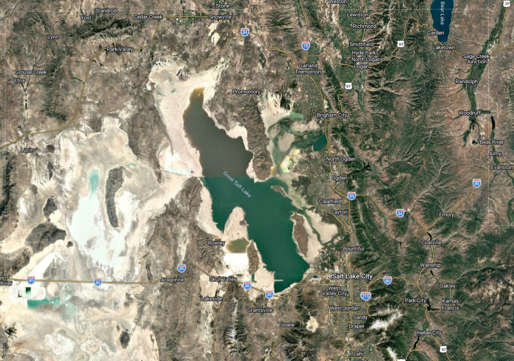
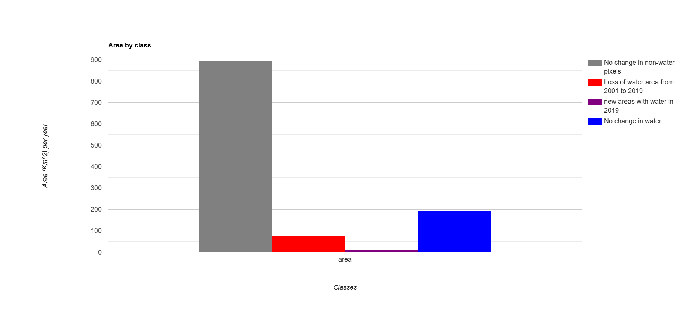

Great Salt Lake Water Change Detection Map

*---------
Interactive Google Earth Engine Online Web Map

The web map is published on Google Earth Engine. A general analysis and methods used is presented below.

[View Full, interactive Google Earth Engine Map here:](https://week-1-project-485022.projects.earthengine.app/view/great-salt-lake-water-change-detection)
*---------
Project Overview:

This project is intended to create a general overview map of the Great Salt Lake in Salt Lake City, UT. The overall intention of the map is to determine whether there has been a change in the amount of water in the Great Salt Lake between the years of 2001 to 2019.

When switching between the layers provided, the results show a red section (on the Water Change layer) that symbolizes the area of water loss within the lake. This polygon shows that ultimately there has been a significant loss of water in the lake from the year 2001 to 2019.
*---------
Water Change Detection Results Image:

Water Change Chart Results:

*---------
Project General Information

This analysis uses USGS National Land Cover Database (NLCD), 2019 image collection 30-m Landsat images through Google Earth Engine to perform the water change analysis.